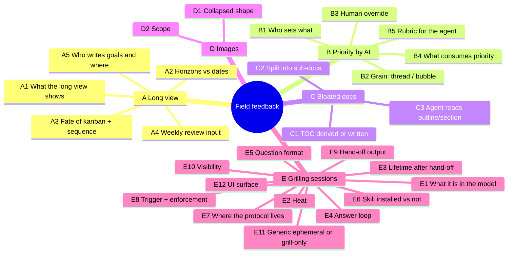

# Grill — field feedback from AYE Tec and Cuby Smart (2026-10-08)

How to answer: write under each `✍️ Answer:` line. **"yes"** accepts the ➡️
recommendation. Anything else, say what and why. I build round 2 from your answers.

---

## 0. What I checked before asking (facts, not decisions)

| Topic | What the repo says today |
|---|---|
| TOC | A heading rail already exists: `ThreadToc.svelte`, fixed right, collapsed to dashes, expands on hover. It's built from the rendered `h1–h3` (`prose.ts › extractHeadings`). goldmark already writes heading IDs. |
| Priority | **Two systems.** Bubble: derived `impact × urgency` (view `bubble_priority`). Thread: **stored** `threads.priority` P1–P4, **written only by the global lead**. PLAN §4 says "store the inputs, derive the verdict". The thread side was a deliberate exception ("one click less"). |
| Planner | Its columns are department `stages`, seeded as horizons: short, medium, long, done. Cards are **bubbles**. Objectives exist (department-level, with an `outcome`). Sequence is a feature flag. |
| Inbox | Department-level, no workspace. Triage turns a note into a bubble: the body goes to the brief, and the note keeps pointing at it. Capturing warms nothing. |
| agents_md | Versioned rows per role (planner / operators). Read live through MCP. The lead edits it in the app. |
| Live UI | One PocketBase SSE stream (`live.svelte.ts`). The UI can already update while an agent writes. |
| Rendering | goldmark (server, GFM, raw HTML **escaped**), then client post-processing in `prose.ts`: mermaid, excalidraw, token-fetched images, live checkboxes. |
| grill-me | `grill-me` is one line: "call `grilling`". The method lives in `grilling` (from `mattpocock/skills`). |
| Thread sub-docs | Already supported: `threads/14-slug/notas.md` sits beside the main doc. Writing there warms the thread. |

---

## 1. Design tree

Round 1 asks only the questions whose prerequisites are settled. The rest is in §3.

---

## 2. Round 1

### A — The long view

❓ **Q1** - **The long view is a roadmap of OBJECTIVES, not of bubbles**: The kanban broke because a team of four makes bubbles faster than a lead can place them. Bubbles are the wrong grain for months and years. Objectives already exist ("clients", "profitability", "ISO 9001") and they persist. Options:
- (a) A new view whose rows are objectives. Under each one, its bubbles roll up with derived heat ("is anything under this goal alive?").
- (b) Keep the bubble kanban and only add more horizon columns.
- (c) A free-form vision page (wiki doc), with no structure.

➡️ (a). Goals and dreams are what persist, and objectives are already the department's strategic layer. Heat rolling up to objectives extends what you said worked ("heat at all entities") one level higher.

✍️ Answer: yes, sounds good

---

❓ **Q2** - **Bubble produces the weekly meeting's input, derived from `events`**: You replaced the planner with a weekly meeting. Every piece of evidence is already an event row (doc changed, thread created/completed, link added). Should Bubble produce a "what changed reality this week" digest per objective → bubble → thread, plus what went 😴/🪦, so the meeting reviews it instead of reconstructing it?

➡️ Yes. It is derived, costs nobody any writing, and it is the honest version of "summarize the work done".

✍️ Answer: Yes, that'd be awesome

---

### B — Priority assigned by AI

❓ **Q3** - **The agent sets the inputs (impact, urgency), never the verdict**: This is PLAN §4's own rule. If the agent writes `P1` directly, the map becomes decoration again. The thread side stored a letter only to save a human a click, and an agent pays no clicks. Proposal: threads go back to `impact × urgency` (derived priority), written by the agent when an operator starts or continues work, and the stored `threads.priority` is dropped.

➡️ Yes. Derived thread priority, with agent-written inputs.

✍️ Answer: Ok

---

❓ **Q4** - **Priority needs a consumer, not just a setter**: "Priority is there but not used" is partly because it was manual. It is also because nothing *does* anything with it. Should priority order `next`, order the weekly digest (Q2), and raise a **cold P1/P2** alert (the signal PLAN §4 calls the most useful one)?

➡️ Yes, all three. A field nothing reads will stay unused even if an AI fills it.

✍️ Answer: No, order is still manual for now

---

### C — Bloated thread documents

❓ **Q5** - **The TOC is derived and rendered on top, not written by the agent**: You asked for the minimal change, "suggest a TOC in the operators agents_md". The catch: an agent-written TOC drifts on the next edit, costs tokens on every write, and is a stored copy of something derivable. That is the exact pattern Bubble rejects everywhere else. Options:
- (a) agents_md suggests a hand-written TOC (your proposal).
- (b) The server renders a TOC block at the top of every thread from its headings (a goldmark extension, about a dozen lines). It never drifts and the agent never writes it.
- (c) Make the existing right-hand rail more discoverable instead.

➡️ (b). It is still a minimal change and it can't lie. Did you know the rail (c) existed? If not, that is a finding too.

✍️ Answer: Yes, b

---

❓ **Q6** - **agents_md tells operators to split long docs into the thread's folder**: The folder `threads/<n>-slug/` already exists for this. Rule of thumb: the main doc stays as why, done-when, next and checkboxes, plus links to `research.md`, `design.md` and `log.md` beside it once a section grows past roughly one screen.

➡️ Yes, as a suggestion in operators' agents_md (never enforced, per decision 0005).

✍️ Answer: Yes

---

❓ **Q7** - **`read` can return an outline and a single section**: Bloat hurts the agent too, because every `read` loads the whole doc into context. Add `read(path, outline: true)` → headings + checkbox counts, and `read(path, section: "<heading>")`.

➡️ Yes, but after Q5/Q6. It is cheap given `internal/md` already addresses regions.

✍️ Answer: Yes

---

### D — Images

❓ **Q8** - **Collapsed image = a one-line chip, click to expand inline**: Options:
- (a) A chip `🖼 alt-text · filename`, click expands inline, click again collapses.
- (b) A fixed small thumbnail (~80px tall), click opens full size in a dialog.
- (c) Fully hidden behind a `
` per image.

➡️ (b). A thumbnail keeps the glance value (you recognise a screenshot without opening it) and caps the space. (a) if you want maximum density.

✍️ Answer: I prefer a chip (a)

---

❓ **Q9** - **Applies to raster images everywhere `Prose` renders; mermaid and excalidraw stay open**: That covers threads, wiki, bubble brief, inbox notes and planner cards (one renderer, one behaviour). Diagrams are what you said works best, so they are not collapsed.

➡️ Yes.

✍️ Answer: Yes

---

### E — Grilling sessions (ephemeral artifacts)

❓ **Q10** - **A grilling session hangs off an INBOX ITEM, and triage is its hand-off**: The inbox already is "before anyone knows what this belongs to". It is department-level, has no workspace, warms nothing, and triage already turns it into a bubble while keeping the pointer. A grill is the same thing, plus rounds of questions. Options:
- (a) Inbox item + `grill_rounds/questions` hanging from it. Hand-off = triage, extended to "existing thread / new thread in bubble X / new bubble / new workspace".
- (b) A new standalone `grills` collection with its own lifecycle.

➡️ (a). One pre-work concept instead of two that differ only in whether questions were asked.

✍️ Answer: Yes, reusing inbox items sounds good but remember to scope to their creators and I still want to use them as backlog items

---

❓ **Q11** - **Grilling warms nothing**: It is thinking before work, like capture. The thread or bubble born at hand-off warms (thread-created). Otherwise a long grill on a new idea would float as 🔥 with no reality changed.

➡️ Yes.

✍️ Answer: Yes

---

❓ **Q12** - **Bubble ships ONE self-contained grilling protocol, whether or not the skill is installed**: The server cannot know which skills a harness has. Two prompts (installed vs raw) would be two methods that drift. The `grilling` method is about 20 lines, so Bubble can carry its own version, written for Bubble's I/O (post round → wait → read answers). An installed skill then adds nothing and conflicts with nothing. Instruction: "when grilling, use Bubble's protocol even if you have a grill skill."

➡️ Yes. This drops your two-case design in favour of one path. Say no if the installed case must keep the skill's exact wording (licence check in §4).

✍️ Answer: Yes

---

❓ **Q13** - **Answer loop v1: post the round → answer in Bubble OR the terminal → nudge → agent reads**: Options:
- (a) The agent posts the round and ends its turn with "answer in Bubble or here". You answer in the UI and type anything ("ok") in the harness. The agent calls `grill_answers` and builds the next round.
- (b) The agent blocks on a long-poll MCP call until you submit in the UI, then continues on its own. This is magical, but it depends on per-harness tool timeouts (Codex/Claude Code/pi differ, see §4) and burns calls while it waits.
- (c) MCP elicitation, where the harness asks the questions in its own UI. That is not Bubble's UI, so the visual point is lost.

➡️ (a) now. (b) as an experiment once the timeouts are known.

✍️ Answer: A) is good enough

---

❓ **Q14** - **Questions are STRUCTURED, not a markdown blob**: Each question carries id, round, title, body, choices[], recommendation, and answer (`accepted` | `override` + text). That buys the UI an "accept ➡️" button per question and "accept all", and it lets round N+1 know exactly what was settled. The round is still rendered as markdown/mermaid for reading.

➡️ Yes.

✍️ Answer: Yes

---

❓ **Q15** - **Grilling is OFFERED before creating a workspace/bubble, never REQUIRED**: README decision 0005 removed the birth rule because severity pushed work outside the tool. A mandatory grill is a birth rule with more steps. agents_md would say: "before `create_bubble`/`create_workspace` on something not yet discussed, offer a grill."

➡️ Yes, offered only.

✍️ Answer: yes

---

❓ **Q16** - **Only a harness starts a grill; Bubble runs no model**: The alternative is Bubble calling an LLM API itself, so you could start a grill from the UI on an inbox note with no harness open. That adds keys, cost, a model choice and a second agent identity.

➡️ Yes, harness-only. The UI may show "copy prompt to grill this note" as the bridge.

✍️ Answer: yes, harness only, and I don't want any copy prompt button, I prefer to make agents_md explicit enough

---

❓ **Q17** - **Build grill-only now; generalise "ephemeral artifact" at the second kind**: You called this "the first kind". Designing the abstraction from one example usually gets it wrong.

➡️ Yes. Name what the second kind might be (brainstorm? brain dump? spike notes?) in your answer, so I can avoid closing doors.

✍️ Answer: Make it general, we later add other types

---

## 3. Later rounds (blocked on round 1)

| Branch | Waits for | The question |
|---|---|---|
| A2 Horizons vs dates | Q1 | Objectives on fuzzy horizons (this quarter / this year / someday) or dates? |
| A3 Kanban + sequence | Q1, Q2 | Demote the bubble kanban (flag off), keep it, or remove it? |
| A5 Goals authoring | Q1 | Lead-only? Is an objective's outcome enough, or does it need a long-form "why" (vision)? |
| B2 Grain | Q3 | Does the bubble keep lead-set impact × urgency while threads become agent-set? |
| B3 Override | Q3 | A human-set value is sticky and the agent never overwrites it (needs provenance: `set_by`)? |
| B5 Rubric | Q3, Q1 | Where the agent's impact/urgency rubric lives (planner agents_md?) and whether it reads objectives. |
| E3 Lifetime | Q10 | After hand-off: keep the Q&A as a read-only record linked from the thread, or purge it after N days? |
| E7 Protocol home | Q12 | Tool contract in embedded `guide` and method/tone in lead-editable agents_md, or all in one? |
| E9 Hand-off output | Q10, Q14 | What gets written into the thread: decisions + rejected options (`### Decisions`), open questions, first checkboxes? Can one grill yield several threads? |
| E10 Visibility | Q10 | Department-visible read-only, or private until hand-off? Can several people answer (a grill in a meeting)? |
| E12 UI | Q10, Q13, Q14 | Its own screen with a live design tree + question cards, or inside the inbox sheet? |

---

## 4. Facts I still owe you (I look these up, not you)

- [ ] ~~MCP tool-call timeout defaults~~. Dropped: Q13 = (a), so no long-poll.
- [x] Licence of `mattpocock/skills`: **MIT** (GitHub API). Bubble may adapt `grilling`'s text if it keeps the copyright notice.
- [x] `go.abhg.dev/goldmark/toc`: `toc.Extender{Title, TitleID, ListID, MinDepth, MaxDepth, Compact}` puts a TOC at the top of every document, and `toc.Transformer` gives more control. Our `gm` instance renders threads, wiki and briefs alike, so thread docs need **their own** instance (or the Transformer) to get a TOC only there.
- [ ] Bundle cost of `markmap-view` vs the already-bundled mermaid `mindmap` (proposal 3 below).

---

## 5. Render proposals (you asked; none are decided)

| # | For | Proposal | Why | Cost |
|---|---|---|---|---|
| 1 | Bloat (Q5) | **goldmark-toc** (`go.abhg.dev/goldmark/toc`) on the server | Same renderer, derived, never drifts | One Go dep |
| 2 | Bloat | **Foldable headings in the rendered view** (client-side, `prose.ts`), with `## Logbook` folded by default | Long docs become scannable without changing a byte on disk | No dep |
| 3 | Grill design tree, long-doc outline | **Markmap** (`markmap-lib` + `markmap-view`): markdown outline → interactive, foldable mind map | The grill's design tree IS an outline. Answered nodes coloured, the frontier highlighted. It also works as an "outline view" of any bloated doc | New dep, measure first. Fallback: mermaid `mindmap`, already bundled |
| 4 | AI priority | Mermaid **`quadrantChart`** of open threads on impact × urgency | Lets you *see* what the agent decided, at a glance | Already bundled |
| 5 | Long view (Q1) | **Now / Next / Later swimlanes per objective in plain Svelte**, not a Gantt | An uncertain future doesn't want a Gantt's false precision. Mermaid `timeline` works for a read-only export | No dep |
| 6 | Images (Q8) | Native `<dialog>` for the full-size view; **PhotoSwipe** only if you want zoom/pan/swipe on mobile | Thumbnails + dialog need no library | No dep / one dep |
| 7 | Architecture diagrams | **D2** (Go library, could render SVG server-side inside the binary) | Better auto-layout than mermaid for big system diagrams | Heavy. "Watch", not now |

Pipeline stays the same shape: **goldmark (single source of HTML) → `prose.ts` post-processing**. Every proposal above is either a goldmark extension or a post-processing step, so there is still one renderer.

---

## 6. Round 1: what is settled

| Q | Decision |
|---|---|
| Q1 | The long view is a roadmap of **objectives**. Bubbles roll up under them with derived heat. |
| Q2 | Bubble derives a weekly digest from `events` for the meeting. |
| Q3 | Threads go back to `impact × urgency` written by the agent. Priority is derived and `threads.priority` is dropped. |
| Q4 | **No.** Priority orders nothing: `next`, the digest and the columns stay manually ordered for now. |
| Q5 | The TOC is derived by the server and rendered at the top (goldmark-toc). The agent never writes it. |
| Q6 | Operators' agents_md suggests splitting long docs into `threads/<n>-slug/`. Never enforced. |
| Q7 | `read` gains `outline` and `section`, after Q5/Q6. |
| Q8 | Collapsed image = **chip** (a), click to expand inline. |
| Q9 | Raster images only, everywhere `Prose` renders. Diagrams stay open. |
| Q10 | A grill hangs off an **inbox item**, and triage is the hand-off. **Plus:** scoped to its creator, and inbox items remain usable as backlog. |
| Q11 | Grilling warms nothing. |
| Q12 | One protocol, shipped by Bubble. An installed skill is irrelevant. |
| Q13 | Answer loop (a): post the round, answer in Bubble or the terminal, nudge, agent reads. |
| Q14 | Questions are structured rows/fields with accept/override. |
| Q15 | A grill is offered before creating a workspace/bubble, never required. |
| Q16 | Harness-only. **No copy-prompt button**: agents_md must be explicit enough on its own. |
| Q17 | **Make it general now** (overrides my recommendation). Grill is the first `kind`; others come later. |

Two answers reshape the tree:
- **Q4 = no** leaves AI priority with nothing that reads it. Round 2 has to say what it is *for* (Q19).
- **Q10's "scoped to creators" + "backlog"** changes who can read the inbox, which today is everyone signed in (Q25, Q26).

---

## 7. Round 2

### A — Long view and weekly digest

❓ **Q18** - **Objectives sit on fuzzy horizons, not dates**: Each objective gets a horizon: `now` (this quarter) · `next` (this year) · `later` (someday/dream). An optional target date is allowed but never required. The roadmap is three swimlanes. Dates on dreams are false precision, and a missed fake date teaches people to ignore the view.

➡️ Yes: horizon required, date optional.

✍️ Answer: Yes

---

❓ **Q19** - **An objective's band = its hottest OPEN bubble's band**: This is the same rule a bubble already uses with its threads, one level up. An objective with no bubbles is 😴 ("nothing promised yet"), like an empty bubble. Objectives with bubbles that are all closed show 🏆 only if the lead closes the objective. They never close on their own, because goals outlive their projects.

➡️ Yes.

✍️ Answer: Yes

---

❓ **Q20** - **The digest window is "since the previous weekly meeting"**: `calendar_events` already holds a repeating weekly meeting. The window runs from its previous occurrence to now. If there is no such event, fall back to the last 7 days. A fixed Monday-to-Sunday window misses whatever happened between the meeting and Monday.

➡️ Yes. Pick the meeting by a flag on the calendar event ("this is the review").

✍️ Answer: Yes

---

❓ **Q21** - **The digest lives in two places: a planner screen, and an MCP tool `review`**: The screen is what you project in the meeting. The MCP tool lets your harness write the narrative summary ("this week Cuby shipped X, Y went cold") from the same derived data. Neither is stored. No weekly snapshot doc either, because a stored digest is a copy of `events` that can disagree.

➡️ Yes, both, nothing stored.

✍️ Answer: I'd like the input summary to be triggered automatically at 00:00 by invoking a `pi` harness or other agnostic cli tool that writes the summary so lead can see what work was done before the meeting

---

❓ **Q22** - **The bubble kanban goes behind a feature flag, off by default**: Q1 replaces it as the long view, and you said it was useless at team scale. Sequence is already flagged. Removing it outright deletes `stages` and the manual ordering you just said stays (Q4).

➡️ Yes, flag it off and decide on deletion after a month on the roadmap.

✍️ Answer: Yes

---

### B — AI priority, given Q4 = no

❓ **Q23** - **Without a consumer, AI priority is a SIGNAL to read, not an order**: It is shown as the badge, as a mermaid `quadrantChart` of open threads per bubble, and in the digest's text (not its order). The one thing I'd still keep is a **cold P1/P2 marker**: a visual flag, not an alert and not a reordering. Does your Q4 "no" also cover that marker?

➡️ Keep the marker (a 🧊 on the badge), no reordering anywhere.

✍️ Answer: Keep priority markers, but it wont affect reordering

---

❓ **Q24** - **Any member's agent writes a thread's impact/urgency, a human's value is sticky, and the bubble's stays lead-only**: `threads.priority` is lead-only today. If only the lead's agent may set it, operators' agents can't, and Q3 fails. Proposal:
- threads: `impact`, `urgency` and `priority_set_by` (`agent` | `human`) plus a one-line `priority_reason`. Any member's agent may write them; an agent never overwrites `human`.
- bubbles: unchanged, impact × urgency set by the lead.

➡️ Yes.

✍️ Answer: Non-lead agents should know about priorities and goals, so operators agent should seed threads with it.

---

❓ **Q25** - **The agent's rubric lives in the PLANNER agents_md and is fed the objectives**: The lead writes what "high impact" means at Cuby (clients blocked? revenue? ISO?). The tool response of `agents_md` for operators carries that rubric section too, plus the thread's bubble's objective, so the agent judges against the company's goals, not its own taste.

➡️ Yes. The lead owns the rubric, and both roles receive it.

✍️ Answer: Yes

---

### C/D — TOC and images

❓ **Q26** - **TOC only on thread docs, only with ≥3 headings, collapsed to one line by default; the right rail stays**: The wiki has its own navigation, a short doc doesn't need one, and an always-open TOC is the same space problem as the images. The rail stays because it tracks where you are as you scroll, which the top TOC can't.

➡️ Yes.

✍️ Answer: Yes

---

❓ **Q27** - **Chip label = alt text, falling back to filename; expanded state not remembered**: Every reload starts collapsed, which is the point. Agents should write meaningful alt text, so operators' agents_md says so.

➡️ Yes.

✍️ Answer: Yes

---

### E — Grilling on the inbox, made general

❓ **Q28** - **"Scoped to creators" = an inbox item is readable by its creator and the global lead, for ALL items**: Today everybody signed in reads the inbox. Options:
- (a) All items: creator + global lead. The lead keeps triage, but teammates no longer see each other's notes.
- (b) Only items with an artifact (a grill) are private. Plain notes stay department-visible.
- (c) Each item has a `private` toggle and defaults to private.

Caveat for (a): WhatsApp notes are `captured_by` whoever turned the channel on (you), so teammates stop seeing them.

➡️ (b). It is the smallest change to an existing rule, and half-formed thinking is what deserves privacy, not a captured note.

✍️ Answer: Let's go for a)

---

❓ **Q29** - **"Backlog item" = an inbox item stays untriaged as long as needed, grilled or not**: A grill ends by *offering* the hand-off, and "not yet" is a valid answer. The item stays in the inbox as backlog, now carrying its grill. The inbox gets a filter: `new` · `grilled` · `triaged`.

➡️ Yes. If you meant something else by backlog (a separate backlog list? lead-curated?), say so.

✍️ Answer: Yes, inbox is a backlog item

---

❓ **Q30** - **General shape: `artifacts` (kind, inbox item, creator, status) + append-only `artifact_entries` (artifact, seq, type, JSON, author)**: For a grill, the entry types are `question`, `answer`, `tree` and `handoff`. Append-only entries mean the agent writing round 3 and you answering Q12 never write the same row (no conflicts), every change streams live over SSE, and a new kind only adds entry types plus a Go validator per kind. Alternative: one JSON blob per artifact. It is simpler, but the agent and you would race on it.

➡️ Yes, artifacts + append-only entries, validated per kind in Go.

✍️ Answer: Yes

---

❓ **Q31** - **Each question carries `depends_on[]`, and Bubble derives the tree and frontier**: The agent doesn't draw the design tree. It declares dependencies, and the UI renders the mindmap (answered = filled, frontier = highlighted, blocked = dim). This is the same derived-not-stored rule as heat.

➡️ Yes.

✍️ Answer: Yes 

---

❓ **Q32** - **Answers given in the terminal are written back to Bubble by the agent**: Q13 allows answering in either place. If terminal answers stay in the chat, the Bubble record has holes and round N+1 builds on an incomplete tree. The agent records them as `answer` entries marked `via: harness`.

➡️ Yes.

✍️ Answer: Yes

---

❓ **Q33** - **"Ephemeral" = outside git, outside the board and heat. It is NOT deleted**: The record stays read-only after hand-off and the thread doc links to it. Its rejected options are exactly what PLAN says makes a choice readable. Deleting after N days loses that.

➡️ Yes, keep forever and read-only after hand-off.

✍️ Answer: No, ephemeral means custom x days of quaranten, but I want a way to lock in so they doesn't expire, but default behavior is to delete after N days.

---

❓ **Q34** - **Hand-off writes a distilled summary into the target, and one grill may produce several targets**: The thread doc (or bubble brief) gets: the decisions, `### Rejected` with the alternatives and why, open questions, and the first `- [ ]` steps, plus a link to the grill. The agent proposes targets after `search` (existing threads first, per house rules), and the user confirms each one. One grill → N threads across bubbles is allowed.

➡️ Yes.

✍️ Answer: Grill is no longer required, the evolution is the thread so no references to grill, the thread is the product of that grill

---

❓ **Q35** - **The protocol is embedded in the server and delivered INSIDE the `agents_md` response; the lead's docs say when to offer and the tone**: Q16 wants agents_md explicit, but there are two role docs (planner/operators). Copying the protocol into both makes it drift, and it names server tools that change with the binary version. Options:
- (a) Embedded `prompts/grill.md` (MIT notice kept), which the `agents_md` tool appends for both roles. The lead's docs only add "when to offer" and the tone.
- (b) A third, lead-editable `shared` agents_md doc, appended to both roles.
- (c) The lead writes it into both docs by hand.

➡️ (a). The agent still receives it through `agents_md`, and nobody can edit away the tool contract by accident.

✍️ Answer: Yes, a)

---

❓ **Q36** - **The UI is the inbox item's sheet, widened, with the grill as a live side panel**: Left: the note. Right: the design tree (mermaid `mindmap`, already bundled) above the current round's question cards with ✅ accept / ✏️ override / "accept all". A 🔴 live dot on the item while an agent is mid-round, and the inbox list shows which items are being grilled. No new top-level screen.

➡️ Yes. Mermaid first, and Markmap only if the mindmap gets too big to read.

✍️ Answer: Yes

---

❓ **Q37** - **The MCP tools are generic, with `kind` as a parameter**: `artifact_start(kind, inbox_item? | topic)` (creates the inbox item if none), `artifact_append(id, entries[])`, `artifact_read(id, since_seq?)`, `artifact_handoff(id, targets[])`. Not `grill_*`. Q17 says general, and a new kind should not add four tools.

➡️ Yes.

✍️ Answer: Yes

---

## 8. Round 2: what is settled

| Q | Decision |
|---|---|
| Q18 | Objectives sit on horizons `now` · `next` · `later`. The date is optional. |
| Q19 | An objective's band = its hottest open bubble's band. Only the lead closes an objective. |
| Q20 | The digest window runs from the previous weekly meeting to now (7 days if there is none). |
| Q21 | **Changed:** a summary is **generated automatically at 00:00** by a CLI harness (pi or any other), so the lead reads it before the meeting. A generated summary is therefore **stored**. |
| Q22 | The bubble kanban goes behind a flag, off by default. |
| Q23 | Priority markers stay (including cold P1/P2). Nothing is reordered by priority. |
| Q24 | **Partly:** operators' agents know the priorities and goals and **seed** a thread's impact/urgency. Still open: revising later, and human values being sticky (Q43). |
| Q25 | The lead writes the rubric in the planner agents_md, and both roles receive it plus the bubble's objective. |
| Q26 | TOC on thread docs only, with ≥3 headings, collapsed to one line. The rail stays. |
| Q27 | Chip label = alt text, then filename. Nothing is remembered. |
| Q28 | (a): **every** inbox item is readable by its creator and the global lead only. |
| Q29 | An inbox item is a backlog item; it stays untriaged as long as needed. Filter: new · grilled · triaged. |
| Q30–Q32 | `artifacts` + append-only `artifact_entries`. Questions carry `depends_on[]` and the tree is derived. Terminal answers are written back. |
| Q33 | **Changed:** "ephemeral" = **deleted after N days**, unless it is locked. |
| Q34 | **Changed:** the thread is the product. **No reference to the grill**; the thread stands on its own. |
| Q35 | The protocol is embedded and delivered inside the `agents_md` response. |
| Q36 | The UI is the inbox sheet, widened, with a live grill side panel. |
| Q37 | Generic `artifact_*` MCP tools with `kind`. |

---

## 9. Round 3

### A — The nightly summary (from Q21)

❓ **Q38** - **The nightly run lives OUTSIDE the binary: a timer on reko-3 runs the CLI**: Q16 says Bubble runs no model. A binary that execs `pi` would also need pi, its keys and its config inside the Coolify container. Options:
- (a) A systemd timer on reko-3 (`scripts/digest.sh`, one unit per instance: Cuby and AYE Tec separately) runs `<cli> "<prompt>"` against that instance's MCP.
- (b) The binary has a scheduler that execs a configured command (`BUBBLE_DIGEST_CMD`).

➡️ (a). Bubble stays model-free and the harness stays swappable. reko-3 is already where scheduled infra lives.

✍️ Answer: I'd like binary to be fully capable and self contained so it can do everything

---

❓ **Q39** - **It runs every night at 00:00, and its window is always "since the previous meeting"**: The lead always has a fresh summary, including mid-week. The alternative, "only the night before a meeting", saves tokens but needs the timer to read the calendar.

➡️ Yes, nightly. It is cheap at four people, and the timer stays dumb.

✍️ Answer: Yes

---

❓ **Q40** - **Summaries are stored as department `digests` rows, and they warm nothing**: Each row holds window_from, window_to, a markdown body and the agent that wrote it. One row per run is appended, never edited. The planner's digest screen shows the latest one **above** the derived data it was written from, so the lead can check the story against the facts. They are not wiki pages, because the department has no git tree (wiki pages belong to workspaces).

➡️ Yes. The derived data screen stays, and the stored narrative sits on top of it.

✍️ Answer: Yes

---

❓ **Q41** - **The CLI prompt is one line, and the instructions come from the `review` tool**: The timer runs e.g. `pi -p "Call bubble's review tool and do what it says."`. `review` returns the window's data plus the embedded instructions (`prompts/digest.md`, versioned with the binary), and the tone comes from the planner agents_md. Swapping pi for Codex/Claude only changes the command, never the prompt.

➡️ Yes.

✍️ Answer: Yes

---

❓ **Q42** - **The run uses the lead's agent token (planner role)**: The digest reads the whole department, which only the global lead can see. The alternative is a dedicated "digest" person, but persons are meant to be humans.

➡️ Yes, the lead's agent token, kept on reko-3 in the timer's environment file.

✍️ Answer: Yes

---

### B — Priority follow-up (from Q24)

❓ **Q43** - **The agent seeds impact/urgency at creation, may revise them when work continues, and never overwrites a human's value**: "Seed" alone would freeze the first guess. Q3 said the agent sets them when operators *start or continue*. Revising needs `priority_set_by` (`agent` | `human`) so a lead's correction sticks, plus a one-line `priority_reason` so the lead can see why.

➡️ Yes: seed + revise + human-sticky + reason.

✍️ Answer: Yes

---

### E — Expiry and hand-off (from Q28, Q33, Q34)

❓ **Q44** - **WhatsApp notes become lead-only, and you accept that**: Under Q28 (a), channel notes are `captured_by` whoever turned the channel on (you), so teammates no longer see what the group sends. The alternative is mapping the sender's phone (`source_from`) to a person so they own their note, which means a phone field on people.

➡️ Accept it for now. You triage them anyway.

✍️ Answer: WhatsApp is and will never be used so we may purge this feature

---

❓ **Q45** - **Only the ARTIFACT expires, never the inbox item**: The inbox item is backlog (Q29). If it vanished with its grill, the backlog would delete itself. When the grill expires, the item just goes back to `new` (or stays `triaged`).

➡️ Yes.

✍️ Answer: A grill has an inbox item linked?

---

❓ **Q46** - **The N-day clock starts at the LAST ENTRY, and restarts at hand-off**: A grill you abandon mid-way expires N days after you last touched it. A grill you hand off expires N days after the hand-off, which leaves time to check the thread got everything. Counting from creation would kill a slow grill while you are still in it.

➡️ Yes.

✍️ Answer: Yes

---

❓ **Q47** - **N is one department setting (default 30 days) set by the lead. The 📌 lock belongs to the creator or the lead, and the UI warns before expiry**: The sheet shows "expires in X days" and the list flags items with less than 3 days left. Deletion is a hard delete of the artifact and its entries (nothing goes to git, so nothing lingers). A locked artifact never expires until it is unlocked, and unlocking restarts the clock.

➡️ Yes, with 30 as the default.

✍️ Answer: Yes

---

❓ **Q48** - **Because the grill will vanish, the thread must carry what it needs: decisions WITH the rejected alternatives, open questions, and first steps**: No link back (Q34), so the hand-off writes everything worth keeping into the thread doc (or bubble brief). That includes a `### Decisions` section where each decision says what it rejected and why, because that is the one thing a deleted grill would otherwise take with it. One grill may still produce several threads, each confirmed by you.

➡️ Yes.

✍️ Answer: Yes

---

## 10. Round 3: what is settled

| Q | Decision |
|---|---|
| Q38 | **Changed:** the binary is fully capable and self-contained. The nightly summary is scheduled **inside** it (see Q49). |
| Q39 | Nightly at 00:00. The window is always "since the previous meeting". |
| Q40 | Summaries are `digests` rows (department-level, append-only). They warm nothing and are shown above the derived data. |
| Q41, Q42 | Accepted, but **superseded by Q38** if the binary makes the call itself (see Q52). |
| Q43 | Agent seeds + revises, a human's value is sticky, with a one-line reason. |
| Q44 | **Changed:** WhatsApp will never be used, so **purge the feature** (see Q54). |
| Q45 | **Open:** you asked "a grill has an inbox item linked?" (see Q55). |
| Q46 | The clock starts at the last entry and restarts at hand-off. |
| Q47 | N is a department setting (default 30 days). 📌 lock by the creator or the lead. The UI warns before expiry. |
| Q48 | The thread carries decisions with the rejected alternatives, open questions and first steps. |

Fact: PocketBase ships a scheduler, `app.Cron().Add(id, "0 0 * * *", fn)`. PocketBase itself uses it for log cleanup, so scheduling needs no new dependency.

---

## 11. Round 4

### The nightly summary, self-contained

❓ **Q49** - **"Self-contained" = the binary calls an LLM API directly, rather than exec'ing a harness CLI**: Options:
- (a) The binary schedules a job and **execs a CLI** (pi/claude/codex). It is not really self-contained: the CLI, its runtime and its login must exist on the host or in the container image.
- (b) The binary schedules a job and **calls a model API itself**: one request (the window's derived data + instructions → markdown), with no tools and no agent loop. Only the binary and a key are needed.
- (c) Both, configurable.

A summary is one completion over data Bubble already has, so it doesn't need an agent.

➡️ (b).

✍️ Answer: I prefer only a)

---

❓ **Q50** - **The provider is an OpenAI-compatible endpoint (base URL + model + key), configured by whoever runs the box, not in the app's UI**: OpenAI-compatible covers OpenAI, OpenRouter, Anthropic's compatibility endpoint, and local servers (Ollama, LM Studio). The config lives in env vars or the superuser dashboard, where secrets already live. It is not a lead-editable Settings field, because that would put a paid API key in front of everyone who can reach the lead's session.

➡️ Yes.

✍️ Answer: Yes

---

❓ **Q51** - **Grilling stays harness-only (Q16 stands). The model inside the binary is ONLY for the digest**: A model in the binary could tempt "grill from the UI with no harness open". That brings back the agent identity, tool loop and cost you rejected in Q16, and it is a much bigger thing than one summary call.

➡️ Yes. The binary's model writes digests and nothing else, until you decide otherwise.

✍️ Answer: Yes

---

❓ **Q52** - **What replaces Q41/Q42: embedded instructions + the planner agents_md tone, read internally; the `review` MCP tool stays for harnesses**: With (b) there is no token and no CLI prompt. The job reads the window directly. Its instructions are `prompts/digest.md` (embedded, versioned with the binary), plus the tone from the planner agents_md. `review` still exists so you can ask your harness for a summary on demand, from the same data.

➡️ Yes.

✍️ Answer: Yes

---

❓ **Q53** - **00:00 in a DEPARTMENT timezone setting, not the server's clock**: Containers usually run in UTC, so "00:00" would land at 18:00 the day before in Mexico. To confirm in code: what zone PocketBase's cron uses by default. The lead picks the timezone in Settings.

➡️ Yes, a department timezone setting.

✍️ Answer: Yes

---

❓ **Q54** - **Failure is visible and retried once; no summary is never silent**: If the call fails (no key, provider down), the digest screen shows "tonight's summary failed: <reason>" above the derived data, which is still there. One retry 15 minutes later, then nothing until the next night. If no provider is configured, the job doesn't run and the screen says why.

➡️ Yes.

✍️ Answer: Yes

---

### WhatsApp purge (from Q44)

❓ **Q55** - **Purge WhatsApp AND the channel framework; keep the provenance columns on existing notes**: The channel framework (`internal/channels`, the `channels` collection, `/api/channels/…`, Settings → Channels) exists only for WhatsApp. A plugin system with zero plugins is code to maintain for nothing. The purge:
- delete `internal/channels/**`, `channels_whatsapp.go`, the whatsmeow dependency, `SettingsChannels.svelte` and the routes;
- a migration drops the `channels` collection;
- `pb_data/channels/whatsapp.db` is deleted by hand on each instance;
- keep `inbox_items.source` / `source_ref` / `source_from`. Notes already captured keep saying where they came from, and a future channel would reuse them.
- PLAN.md records it: what was built, why it was removed, and that it was never used.

➡️ Yes, a full purge with provenance kept. Say "WhatsApp only" if you want to keep the framework for a future channel (email?).

✍️ Answer: Yes

---

### The inbox ↔ grill link (from Q45)

❓ **Q56** - **Yes: every artifact belongs to exactly ONE inbox item, and an inbox item may carry several artifacts**: This is what Q10 decided ("a grill hangs off an inbox item"). The inbox item is the *topic and the backlog row*. The artifact is the *conversation about it*, which can expire. Concretely:
- You say "grill me on X" in the terminal → `artifact_start(kind: grill, topic: "X")` creates the inbox item "X" and the grill attached to it.
- You grill an existing note → `artifact_start(kind: grill, inbox_item: <id>)`.
- A grill expires → the artifact is deleted and the inbox item stays as backlog (Q45's point).
- The note can be grilled again later, which creates a new artifact.

➡️ Yes. If you pictured a grill as standalone (no inbox item), say so: it changes where it lives and who can see it.

✍️ Answer: Yes

---

## 12. Round 4: what is settled

| Q | Decision |
|---|---|
| Q49 | **(a) only:** the binary schedules the job and **execs a harness CLI**. It never calls a model API itself. |
| Q50 | **Conflicts with Q49.** Its premise (the binary holds a provider key) no longer exists (see Q57). |
| Q51 | Grilling is harness-only. The scheduled CLI writes digests only. |
| Q52 | **Partly conflicts with Q49.** "Instructions embedded + tone from planner agents_md" survives. "Read internally, no token" depends on Q57. |
| Q53 | 00:00 in a department timezone setting. |
| Q54 | Failure is visible and retried once. If nothing is configured, the screen says why. |
| Q55 | Purge WhatsApp and the channel framework. Keep the `source*` columns. Record it in PLAN.md. |
| Q56 | Every artifact belongs to one inbox item; an item may carry several. |

---

## 13. Round 5 (resolving Q49 vs Q50/Q52)

❓ **Q57** - **The binary PIPES the data to the CLI and keeps its stdout as the digest. The CLI uses no MCP and no token**: With (a) there are two ways for the CLI to reach the data:
- (a) **Pipe:** the binary builds the prompt (derived window data + `prompts/digest.md` + planner agents_md tone), runs `<cmd>` with it on stdin, and stores stdout as the `digests` row. The CLI is used as a model and nothing more.
- (b) **MCP:** the binary runs `<cmd> "call review and do what it says"`, and the CLI connects back to Bubble's MCP with the lead's agent token stored on the box, then writes the digest through a tool. This brings back Q41/Q42.

With (a), Q50 is simply dropped (the CLI owns its provider login) and Q52 holds as written. No Bubble token sits on the box, the binary decides what is stored, and a CLI that misbehaves can only produce a bad summary, not writes.

➡️ (a), pipe.

✍️ Answer: Yes

---

❓ **Q58** - **The command is configured by whoever runs the box (`BUBBLE_DIGEST_CMD`, e.g. `pi -p`), never in the app's UI**: A shell command editable from Settings means anyone holding the lead's session can run code on the server. The lead's Settings only show which command is configured and the last run's outcome.

➡️ Yes.

✍️ Answer: Yes

---

❓ **Q59** - **The official image does NOT bundle a harness. The instance supplies the CLI and its login**: Exec'ing pi inside the Coolify container needs pi, its runtime (Node) and its credentials in there. Options:
- (a) Keep the image harness-agnostic. Each instance mounts or installs its CLI and credentials (documented in `deploy/README.md`). If they're missing, Q54's "says why" applies.
- (b) Bake pi (and Node) into the official image, so it's "fully capable" out of the box but bigger and tied to one harness.

➡️ (a). The command is harness-agnostic, so the image should be too.

✍️ Answer: Yes

Round 5: **Q57 pipe · Q58 `BUBBLE_DIGEST_CMD` by the box operator · Q59 harness-agnostic image**. All accepted. Q50 is dropped. Q52 holds.

---

## 14. Last two gaps (never asked, found while checking the tree)

❓ **Q60** - **An objective gets a long-form `brief` beside its one-line `outcome`; only the global lead writes either**: You said goals, dreams and desires persist even when the future is uncertain. One 500-character outcome can't hold a dream and the reasoning behind it. Bubbles already solved this the same way: `outcome` is the one-liner you can read at a glance, and `brief` is the markdown notebook with diagrams (same editor, same renderer).

➡️ Yes, mirror the bubble: outcome + brief, lead-only.

✍️ Answer: Yes

---

❓ **Q61** - **Existing `threads.priority` letters are backfilled to one canonical cell and marked `human`**: Dropping the column (Q3) would otherwise erase what the lead already decided. P2 and P3 each come from three cells, so the backfill picks one: P1 → high/high, P2 → high/medium, P3 → medium/low, P4 → low/low. All are `priority_set_by: human`, so agents won't overwrite them (Q43). The backfill is logged per thread.

➡️ Yes.

✍️ Answer: Yes

---

## 15. Shared understanding (confirm before anything is built)

### A. Long view and the weekly meeting
- **Roadmap of objectives** in `now` · `next` · `later` swimlanes. The date is optional. Bubbles roll up under each objective (Q1, Q18).
- An objective's band = its hottest open bubble's band. Only the lead closes it (Q19). It gets a `brief` beside its outcome (Q60).
- **The bubble kanban goes behind a flag, off by default.** `stages` and manual ordering are kept (Q22).
- **Digest** for the weekly meeting:
  - **Window:** since the previous review meeting (a flag on the calendar event), or 7 days if there is none (Q2, Q20).
  - **Derived screen:** a planner screen shows the window's data, and is never stored.
  - **Stored narrative:** department `digests` rows, append-only, which warm nothing (Q40).
  - **Nightly job:** 00:00 in a department timezone setting (Q39, Q53).
    - The binary runs it with PocketBase's own cron and pipes the data, `prompts/digest.md` and the planner tone into `BUBBLE_DIGEST_CMD`. stdout becomes the digest (Q49, Q57, Q58).
    - No token and no provider key in Bubble. The image bundles no harness (Q59).
    - A failure is shown on screen and retried once (Q54).
  - **`review` MCP tool:** harnesses can ask for a summary on demand from the same data (Q52).

### B. Priority
- **Thread priority becomes derived from impact × urgency**, and `threads.priority` is dropped (Q3). The existing letters are backfilled P1→H/H, P2→H/M, P3→M/L, P4→L/L, marked `human` (Q61).
- Operators' agents **seed** impact/urgency at creation and **revise** them as work continues, with a one-line `priority_reason`. They never overwrite a `human` value (Q24, Q43).
- **The rubric lives in the planner agents_md**, and both roles receive it plus the bubble's objective (Q25).
- Bubble priority is unchanged (lead, impact × urgency).
- **Priority orders nothing.** It shows as a badge, a 🧊 cold P1/P2 marker and a `quadrantChart` (Q4, Q23).

### C. Long documents
- **A derived TOC at the top** of thread docs with ≥3 headings, collapsed to one line, using a goldmark-toc instance for threads only. The right rail stays (Q5, Q26).
- **Operators' agents_md suggests** splitting long sections into `threads/<n>-slug/` (Q6) and writing meaningful image alt text (Q27).
- **`read` gains `outline` and `section`**, after the above (Q7).

### D. Images
- **Raster images render as a chip** (alt text → filename), click to expand inline, collapsed again on every reload. This applies everywhere `Prose` renders. Mermaid and excalidraw stay open (Q8, Q9, Q27).

### E. Ephemeral artifacts (grill is the first kind)
- **Model:** general `artifacts` (kind, inbox item, creator, status, 📌 lock) + append-only `artifact_entries` (seq, type, JSON, author), validated per kind in Go (Q17, Q30).
  - Every artifact belongs to one inbox item; an item may carry several (Q10, Q56).
  - Artifacts warm nothing (Q11).
- **Inbox:** **every** item is readable by its creator and the global lead only (Q28). It is the backlog, with filters new · grilled · triaged (Q29).
- **Grill:**
  - Structured questions with `depends_on[]`. The tree and frontier are derived (Q14, Q31).
  - Answer loop: the round is posted, answered in Bubble or in the terminal, then a nudge. Terminal answers are written back (Q13, Q32).
- **Protocol:** one protocol, embedded in `prompts/grill.md` (MIT notice kept) and delivered inside the `agents_md` response. The lead's docs set when to offer and the tone (Q12, Q35). Harness-only, no copy-prompt button (Q16, Q51).
  - **Offered** before creating a workspace/bubble, never required (Q15).
- **Hand-off = triage:**
  - The target thread(s) or brief **stand on their own**: decisions with rejected alternatives, open questions and first `- [ ]` steps. **No link back** (Q34, Q48).
  - One grill may produce several threads, each confirmed by you.
- **Expiry:** the artifact is deleted N days (department setting, default 30) after its last entry. The clock restarts at hand-off. 📌 lock by the creator or the lead. A warning appears with < 3 days left. **The inbox item never expires** (Q45–Q47).
- **MCP:** `artifact_start`, `artifact_append`, `artifact_read`, `artifact_handoff`, with `kind` (Q37).
- **UI:** the inbox sheet, widened, with a live grill side panel: a mermaid mindmap plus question cards (accept / override / accept all), and a 🔴 live dot (Q36).

### F. Removals
- **WhatsApp and the channel framework are purged** (code, whatsmeow, the `channels` collection, routes, Settings → Channels). The `inbox_items.source*` columns are kept. `pb_data/channels/whatsapp.db` is removed by hand. PLAN.md records it (Q55).

### What this reverses in PLAN.md (each to be recorded with what it rejected)
- "Los hilos vuelven a tener prioridad": the stored lead-only P1–P4 on threads → derived, agent-written inputs.
- Inbox readable by everybody signed in → creator + global lead.
- "Canales del inbox": built, never used, removed.
- Phase 5 kanban as the strategic surface → the objectives roadmap. The kanban goes behind a flag.
- **New surface to note:** the server execs a command (`BUBBLE_DIGEST_CMD`). Only the box operator configures it.
- Dropping `threads.priority` and the `channels` collection can't be undone by a migration's `down`, so the major-vs-minor rule in "Versioning" applies when this ships.

---

## 16. After confirmation (2026-10-08, implementing)

| Q | Decision |
|---|---|
| Q62 | The orb sits on every signed-in screen, above the theme button in the bottom-right corner. **Replaces Q36's inbox sheet.** |
| Q63 | "MCP live" = one of your agent tokens called the MCP in the last **5 min** (not 2: the token is stamped once a minute, and an agent waiting for answers makes no calls). |
| Q64 | Clicking opens a standalone view at `/artefacto/<id>`. |
| Q65 | The box lists your own artifacts only, the lead included. |
| — | The uncommitted inbox/`capture` work is committed on its own. The `artifact_*` tools are the only MCP access to the inbox, limited to your own notes. |
