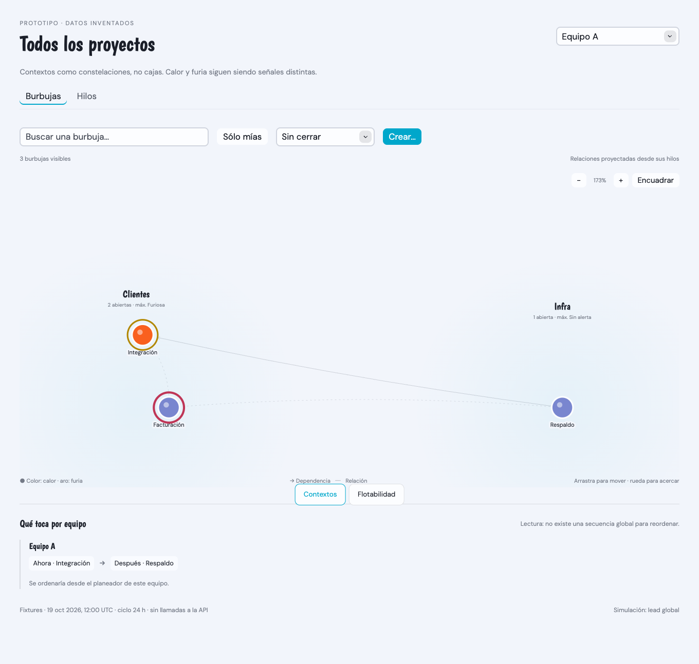
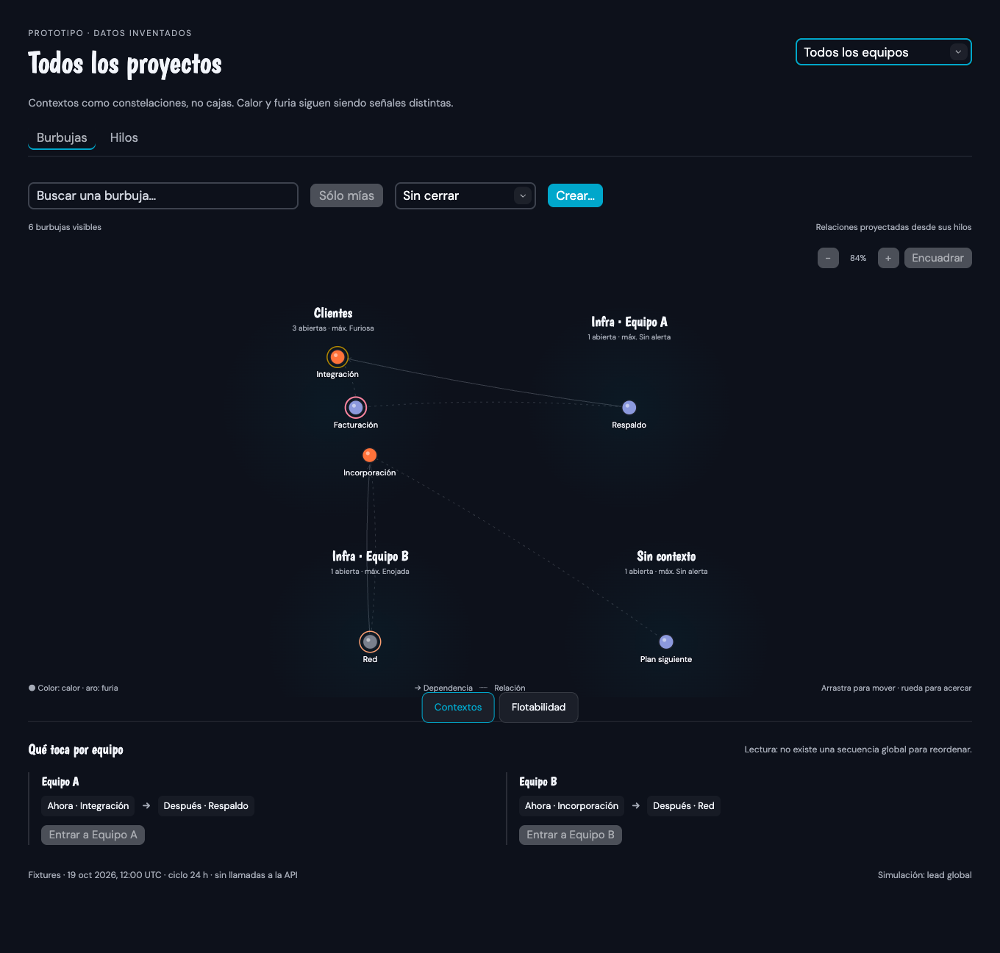
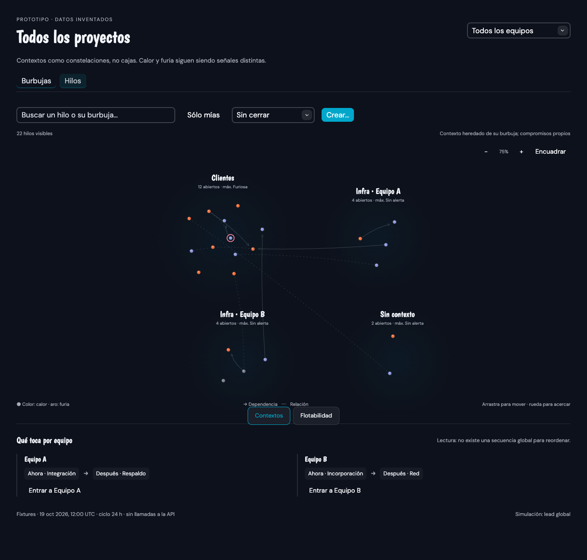
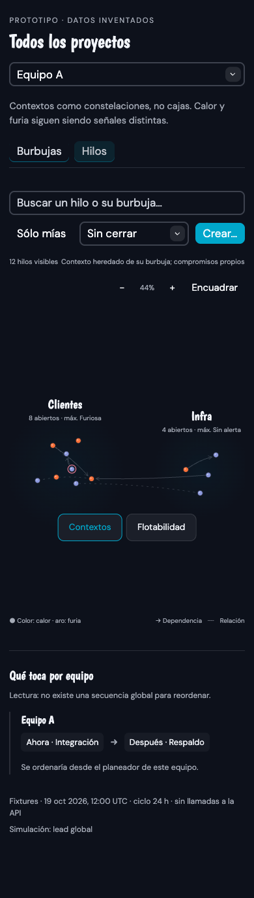
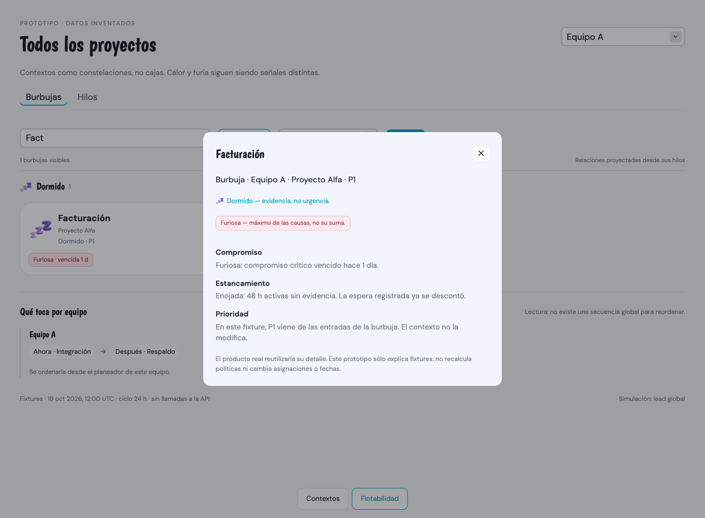
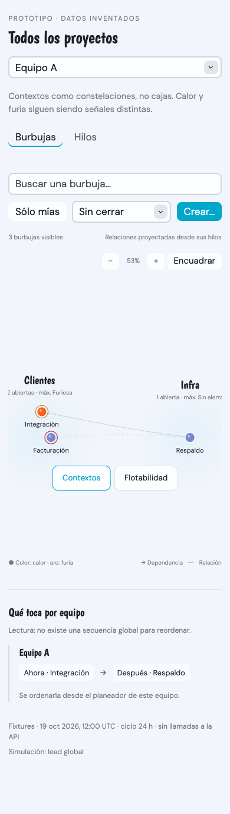
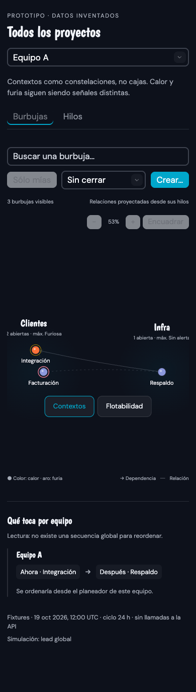

# Prototipo: contextos, furia y Todos los equipos

**19 de octubre de 2026 · diseño para revisión, no funcionalidad del producto.**

- Fuente: [`ModelEvolution.svelte`](../../../frontend/src/prototypes/ModelEvolution.svelte).
- Runner y modo interactivo: [`frontend/tests/browser/README.md`](../../../frontend/tests/browser/README.md).
- Definición/propuesta: [Burbujas, hilo #3](https://bubble.ayetec.space/w/ws-nbu6tp/t/3).

## Abrir para revisar

### Dentro de la app maqueta — para iterar

Con `just dev` corriendo: **http://localhost:5173/theme/mock**. Es la app completa con datos inventados (barra lateral, tablero, cajón, vista de hilo, wiki, planeador), sin iniciar sesión. En desarrollo el tablero lleva encima el modelo:

- Arriba, pestañas **Burbujas / Hilos**; abajo al centro, **Contextos / Flotabilidad** (por defecto Flotabilidad). Ambas se recuerdan al recargar.
- Flotabilidad usa el tablero real de orbes; en Hilos, cada orbe es un hilo con su burbuja como origen.
- Contextos usa el grafo. Pulsar un nodo abre el **cajón real** (burbuja) o la **vista de hilo real** con su título; pulsar el aro de furia abre la explicación con «Abrir».
- Datos: `frontend/src/prototypes/mockModel.ts` (contextos, furia, hilos y relaciones sobre las burbujas de `lib/mock.ts`). Ahí se itera; Vite recarga al guardar.
- Producción: `MockPage` lo carga con import dinámico bajo `import.meta.env.DEV`; el `/theme/mock` publicado sigue siendo el tablero de siempre (comprobado sobre el bundle).
- Límites: la maqueta es un solo proyecto (no hay equipos ni «Todos los equipos»), sin filtros, y en Flotabilidad los orbes no muestran la furia; el documento de la vista de hilo es siempre el mismo texto de ejemplo.

### Prototipo aislado

Con `just dev` corriendo: **http://localhost:5173/theme/model**. No hace falta otro comando ni iniciar sesión. Arriba, las pestañas **Burbujas / Hilos** eligen el nivel; abajo, **Contextos / Flotabilidad** elige la disposición. En Contextos hay un grafo espacial inspirado en la referencia de Obsidian: nodos y conexiones, no tarjetas en cajas. Puedes acercar, desplazar el fondo, arrastrar nodos y pulsarlos para abrir detalle.

`main.ts` monta los fixtures en vez de App sólo bajo `import.meta.env.DEV`; la rama, la URL y el chunk del prototipo se eliminan al construir producción. El tablero normal `/todos` no cambia. Se probó la URL directa, recarga y barra final con una sesión simulada: cero peticiones API/errores. El runner conserva además la página interceptada para automatización y bloquea `/api/` por seguridad. Capturas y ejemplos son inventados; nunca se descargaron tareas o personas reales.

## Qué representa

- Dos ejes independientes: pestañas Skeleton **Burbujas / Hilos** y disposición Contextos/Flotabilidad; conserva búsqueda y «Sólo mías», y recuerda nivel/disposición en preferencias aisladas del fixture.
- Contextos como constelaciones con etiquetas/halos tenues, no contenedores. Layout determinista sobre el universo del fixture: buscar no rebaraja posiciones. El grafo no impone un orden vertical por calor; Flotabilidad sigue disponible para eso.
- Las líneas representan relaciones declaradas de ejemplo; en Burbujas se proyectan desde los hilos, en Hilos muestran sus extremos. Compartir contexto no crea aristas; se omiten extremos filtrados y no se enlazan equipos distintos.
- Calor en el nodo y furia en un aro independiente; conteo abierto y máxima furia por contexto/nivel. Cada hilo conserva su identidad, burbuja/contexto, calor y compromiso propio: no se copia el deadline del resultado.
- Agregado global de equipos compartidos, contexto global común y contextos locales homónimos separados.
- Secuencias paralelas por equipo; crear exige elegir equipo concreto. En este prototipo sólo se elige destino: no se crea un registro.
- Explicación separada de compromiso/estancamiento, cierre mediante filtro y disposición estrecha.

## Comprobado y pendiente

El recorrido automático pasó en Chrome/Chromium contra Vite: ambos niveles, tabs por ratón y teclado, filtros conservados, detalle/cierre con foco listo, zoom, pan, arrastre de nodo sin abrirlo, recarga/preferencia, cero llamadas API y errores de página, y viewport de 390 px sin desborde horizontal. También se revisaron las capturas light/dark, incluidos hilos. `frontend/tests/modelGraph.test.ts` añade 7 pruebas de fixtures/proyección/layout/cámara; `bun run check` comprueba los componentes. Suite completa: 797 live + 65 frontend.

**No probado/implementado:** ACL y migración reales, cálculo/relojes de furia, compromisos, avisos, simulación física continua e integración con el tablero real, rendimiento con muchos elementos, lectores de pantalla o gestos en dispositivo móvil. Los niveles y explicaciones son fixtures congelados con ciclo de ejemplo de 24 h, no la salida de un evaluador nuevo. La conformidad visual de Angel sigue pendiente. El modo `--review` queda disponible; la ejecución validada fue headless.

## Capturas del fixture

### Equipo · claro

### Todos los equipos · oscuro

### Hilos · oscuro

### Explicación de una burbuja dormida y furiosa

### Viewport estrecho · claro y oscuro

